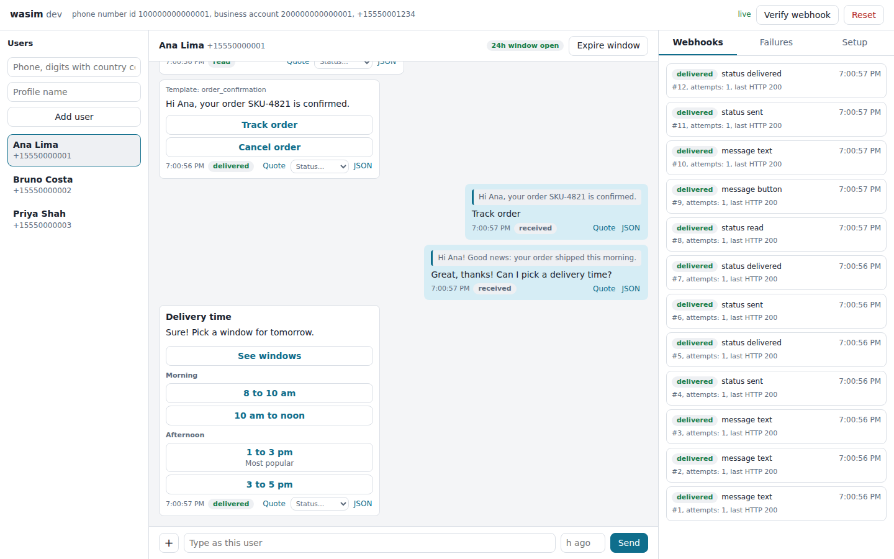
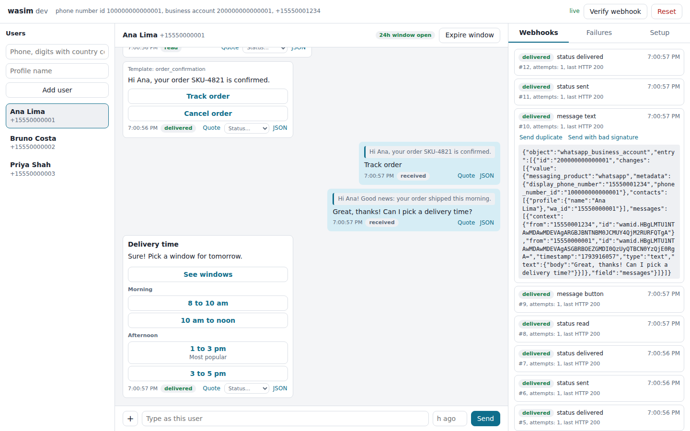
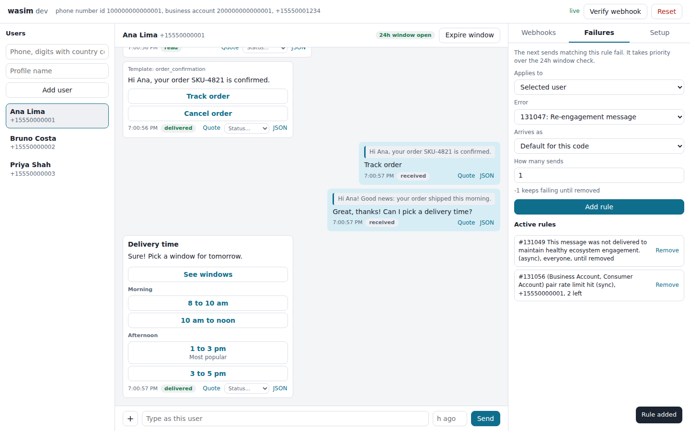

# wasim

[](https://github.com/mvcris/wasim/actions/workflows/ci.yml)
[](https://pkg.go.dev/github.com/mvcris/wasim/cmd/wasim)
[](https://goreportcard.com/report/github.com/mvcris/wasim)
[](LICENSE)

A local emulator of the WhatsApp Cloud API. Test your integration end to end with
no Meta account, no phone and no tunnel: wasim plays Meta's API for your app and
gives you a browser chat where you play the WhatsApp user.

```text
your app  --- POST /v20.0/{phone}/messages --->  wasim  ---> browser console
your app  <-- POST /webhook (signed) ----------  wasim  <--- you, as the user
```

Your app needs no special code path. Point its Graph API base URL at wasim, and its
real client, signature check, webhook handler and queues all run for real.



> wasim is an independent project, not affiliated with or endorsed by Meta.
> WhatsApp is a trademark of its owner.

## Features

- **Sending:** text, reply buttons, lists, and templates with positional or named
  parameters, validated against the documented limits and your template catalog.
- **Webhooks:** signed with `X-Hub-Signature-256`, delivered concurrently, retried
  with backoff until your app answers exactly HTTP 200, and stored in a persistent
  outbox. Trigger duplicates and bad signatures on demand.
- **User actions:** text, images, documents, quoted replies, and taps on buttons,
  list rows and template quick replies.
- **Delivery statuses:** `sent`, `delivered`, `read` and `failed`, automatic or manual.
- **Failure scenarios:** make the next sends fail with real error codes such as
  131047, 131049 or 132000, as an HTTP error or as a failed webhook.
- **24 hour window:** free-form messages fail outside the customer service window.
  Expire it with a click instead of waiting a day.
- **Media:** the real two-step flow, with lookup, an expiring URL and an authenticated download.
- **Template catalog:** listing with `fields`, filters and cursor paging.
- **Single binary:** no CGO, embedded UI and migrations, state in one SQLite file.

## Install

Pick one:

```sh
# Go 1.26 or newer
go install github.com/mvcris/wasim/cmd/wasim@latest

# Docker
docker run --rm -p 127.0.0.1:7070:7070 -p 127.0.0.1:7071:7071 \
  -e WASIM_WEBHOOK_URL=http://host.docker.internal:3000/webhook \
  --add-host host.docker.internal:host-gateway \
  ghcr.io/mvcris/wasim:latest
```

Prebuilt binaries for Linux, macOS and Windows are attached to each
[release](https://github.com/mvcris/wasim/releases).

## Quick start

With Docker Compose, from this repository:

```sh
WASIM_WEBHOOK_URL=http://host.docker.internal:3000/webhook docker compose up --build
```

Or with Go:

```sh
go run ./cmd/wasim \
  --webhook-url http://localhost:3000/webhook \
  --app-secret local-app-secret \
  --verify-token local-verify-token
```

Open the console at <http://localhost:7071>, then configure your app:

| Your app's setting | Value |
|---|---|
| Graph API base URL | `http://localhost:7070` (replaces `https://graph.facebook.com`) |
| Phone number id | `100000000000001` |
| Business account id | `200000000000001` |
| Access token | Any non-empty value |
| App secret | The value of `--app-secret` |
| Webhook verify token | The value of `--verify-token` |

Any `/vMAJOR.MINOR` path prefix works, so your configured Graph version needs no change.

Try it without an app:

```sh
curl -s http://localhost:7070/v20.0/100000000000001/messages \
  -H 'Authorization: Bearer test' \
  -H 'Content-Type: application/json' \
  -d '{
    "messaging_product": "whatsapp",
    "to": "15550000001",
    "type": "template",
    "template": {
      "name": "order_confirmation",
      "language": { "code": "en_US" },
      "components": [{
        "type": "body",
        "parameters": [
          { "type": "text", "text": "Ana" },
          { "type": "text", "text": "SKU-42" }
        ]
      }]
    }
  }'
```

The message appears in the console, ready for you to tap its buttons.

## Templates and contacts

wasim starts with a few sample templates and users. Real approval does not exist here,
so a seeded template is approved unless it says otherwise. Point `WASIM_SEED_FILE` at
your own file, using [`examples/seed.json`](examples/seed.json) as a starting point:

```json
{
  "templates": [
    {
      "name": "appointment_reminder",
      "language": "en_US",
      "category": "MARKETING",
      "parameter_format": "NAMED",
      "components": [
        { "type": "BODY", "text": "Hi {{first_name}}, your appointment is on {{date}}." }
      ]
    }
  ],
  "contacts": [{ "wa_id": "15550000001", "name": "Ana Lima" }]
}
```

The seed runs on every start. Templates are upserted and existing conversations stay.

## Configuration

Every setting is a flag or an environment variable, and the flag wins. See
`wasim --help`.

| Variable | Default | Description |
|---|---|---|
| `WASIM_GRAPH_ADDR` | `127.0.0.1:7070` | Listen address of the fake Graph API |
| `WASIM_CONSOLE_ADDR` | `127.0.0.1:7071` | Listen address of the console |
| `WASIM_PUBLIC_URL` | `http://localhost:7070` | Base URL your app reaches wasim at, used in media and paging URLs |
| `WASIM_WEBHOOK_URL` | | Your webhook endpoint. Empty records webhooks without sending them |
| `WASIM_APP_SECRET` | | Signing secret. Empty sends webhooks unsigned |
| `WASIM_VERIFY_TOKEN` | `wasim-verify-token` | Token used in the verification handshake |
| `WASIM_VERIFY_ON_START` | `false` | Run the handshake at startup, retrying while your app boots |
| `WASIM_ACCESS_TOKENS` | | Accepted bearer tokens, comma separated. Empty accepts any |
| `WASIM_PHONE_NUMBER_ID` | `100000000000001` | Simulated phone number id |
| `WASIM_BUSINESS_ACCOUNT_ID` | `200000000000001` | Simulated business account id |
| `WASIM_DISPLAY_PHONE_NUMBER` | `15550001234` | Simulated business number |
| `WASIM_DB_PATH` | `./wasim.db` | SQLite file, or `:memory:` to start empty every time |
| `WASIM_MEDIA_DIR` | `./wasim-media` | Directory for media files |
| `WASIM_SEED_FILE` | | Templates and contacts. Empty uses the built-in seed |
| `WASIM_AUTO_STATUSES` | `sent,delivered` | Statuses reported after a send, or `none` |
| `WASIM_STATUS_DELAY` | `200ms` | Time between automatic statuses |
| `WASIM_ENFORCE_WINDOW` | `true` | Fail free-form messages outside the 24 hour window |
| `WASIM_WINDOW_ERROR_CHANNEL` | `async` | How that failure arrives: `async` or `sync` |
| `WASIM_ESCAPE_UNICODE` | `true` | Send non-ASCII characters as `\uXXXX` in webhook bodies |
| `WASIM_WEBHOOK_WORKERS` | `4` | Concurrent deliveries |
| `WASIM_WEBHOOK_ATTEMPTS` | `8` | Attempts before giving up on a webhook |
| `WASIM_WEBHOOK_TIMEOUT` | `10s` | Timeout of one attempt |
| `WASIM_WEBHOOK_RETRY_BASE` | `1s` | First backoff delay, doubled on each attempt |
| `WASIM_WEBHOOK_RETRY_LIMIT` | `5m` | Longest backoff delay |
| `WASIM_LOG_LEVEL` | `info` | `debug`, `info`, `warn` or `error` |

## Automating tests

The console API can drive everything the UI does, so a test suite can run wasim as a
dependency:

```sh
# The user sends a message
curl -s localhost:7071/api/contacts/15550000001/messages \
  -H 'Content-Type: application/json' -d '{"type":"text","text":"hello"}'

# The next send to that user fails with a failed webhook
curl -s localhost:7071/api/failure-rules -H 'Content-Type: application/json' \
  -d '{"contact_wa_id":"15550000001","code":131049,"channel":"async","times":1}'

# Close the 24 hour window
curl -s -X POST localhost:7071/api/contacts/15550000001/window/expire

# Start the next test from a clean slate
curl -s -X POST localhost:7071/api/reset
```

Use `WASIM_DB_PATH=:memory:` to make each run start empty.

## Compatibility

wasim checks your integration against the documented contract. It does not
replace a final check with a real test number.

[docs/compatibility.md](docs/compatibility.md) lists everything that is
emulated, everything that is not, and every known drift from the real platform.
The ones most likely to matter:

- No business-scoped user ids (`user_id` and friends, live at Meta since April
  2026), and phone numbers are never rewritten (Meta may change the Brazilian
  ninth digit, for example).
- Status webhooks always have the v24.0+ shape, whatever version you call.
- Retries are compressed from Meta's 7 days to minutes, and rate limits only
  happen when you inject them.
- Not emulated: sending media, uploads, reactions, audio, video, locations,
  Flows, calling, template management and `value.errors` webhooks.

The console has no authentication. See [`SECURITY.md`](SECURITY.md).

<details>
<summary>More screenshots</summary>

Every webhook with its exact signed bytes, ready to resend as a duplicate or
with a bad signature:



Failure rules that make the next sends fail with a real error code:



</details>

## Development

```sh
make test-race   # Go tests with the race detector
make lint        # golangci-lint v2
make e2e         # browser tests of the console (needs Node and pnpm)
make cover       # coverage across packages
```

See [CONTRIBUTING.md](CONTRIBUTING.md) for the rules on emulated behaviour.

## Documentation

- [Compatibility: implemented, missing and known drifts](docs/compatibility.md)
- [Architecture](docs/architecture.md)
- [Errors and source conflicts](docs/errors.md)
- [Research notes on the Cloud API](docs/research/cloud-api-basics.md)
- [Contributing](CONTRIBUTING.md)

## License

[MIT](LICENSE)
